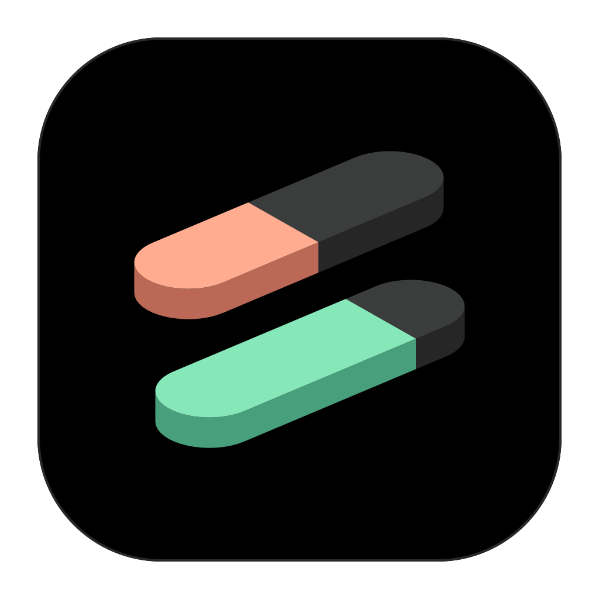
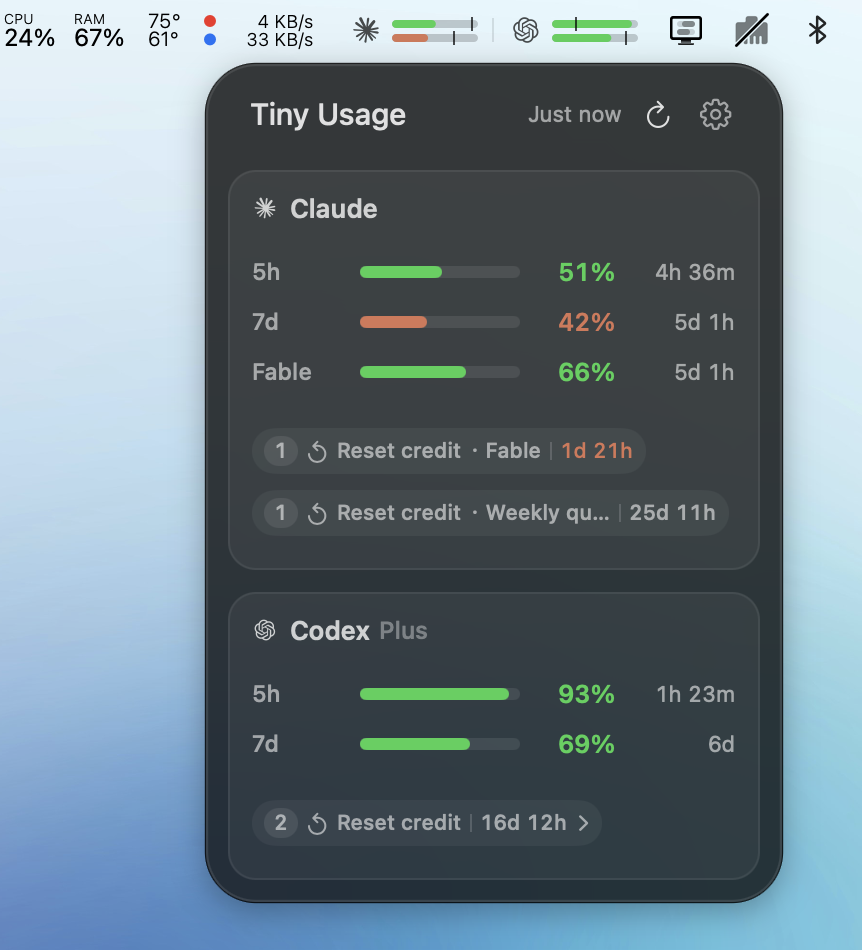

<p align="center">
  
</p>

<h1 align="center">Tiny Usage</h1>

<p align="center">
  See how much Claude, Codex, and OpenCode Go quota you have left and when it resets, right from your Mac menu bar.
</p>

<p align="center">
  <a href="https://tiny-usage.ayue.dev/en">Website</a>
  · <strong><a href="#install">Install</a></strong>
  · <a href="https://github.com/AhaYue/tiny-usage/issues">Feedback</a>
  · <a href="README.md">简体中文</a>
</p>

<p align="center">
  <a href="https://github.com/AhaYue/tiny-usage/releases/latest"></a>
  <a href="https://github.com/AhaYue/tiny-usage/actions/workflows/ci.yml?query=branch%3Amain+event%3Apush"></a>
  
  
  <a href="LICENSE"></a>
</p>

<p align="center">
  
</p>

<p align="center"><strong>See what’s left at a glance, without a click.</strong></p>

## Install

Requires an Apple Silicon Mac running macOS 14 or later.

```sh
brew install --cask ahayue/tap/tiny-usage
```

Or [download the DMG](https://github.com/AhaYue/tiny-usage/releases/latest/download/TinyUsage.dmg) (about 1 MB), open it, and drag **Tiny Usage** to **Applications**.

### First launch

If macOS blocks the first launch, go to **System Settings → Privacy & Security → Open Anyway**.

If you’re signed in to Claude Code, Tiny Usage can query its quota on first launch. For Codex, it uses your existing CLI login and local session history. To add OpenCode Go, open **Settings → OpenCode Go**.

Tiny Usage checks for updates automatically. To check manually, open **Settings → Check for updates**.

Choose **Follow System**, **English**, or **简体中文** in **Settings → Language**. The change takes effect immediately.

## Features

- The menu bar shows quota bars with a marker for the time left in each window. Click the menu bar item to see exact percentages, reset countdowns, and any available reset credits.
- In **Settings → Show in menu bar**, choose any combination of Claude, Codex, and OpenCode Go. If you uncheck them all, the Tiny Usage icon stays in the menu bar. Click it to see all services in the panel.
- In **Settings → Menu bar colors**, choose Default colors, Subtle, or Custom colors. In Subtle mode, bars and percentages with at least 50% remaining match the menu bar icons. In Custom colors, click a swatch to set that quota range’s color using a hex value or the RGB sliders.

## How Tiny Usage reads your quota

Tiny Usage uses your existing Claude and Codex setup, plus OpenCode Go if you connect it. It has no Tiny Usage account, backend, or telemetry. Provider queries go directly from your Mac.

On first launch, Tiny Usage connects to the Claude Code status line. You can disconnect it in Settings.

<details>
<summary>Provider setup, optional authorization, and data sources</summary>

- **Claude Code.** Tiny Usage wraps `statusLine` in `~/.claude/settings.json` and keeps your existing status line running. It backs up the file as `settings.json.tiny-usage-backup` and saves only quota percentages and reset times from the status line. When fresh data is missing, it can run Claude Code’s built-in `/usage` with your existing CLI login to read the 5-hour and weekly quotas. Use **Settings → About → Claude status line → Disconnect** to restore the original status line. Tiny Usage will only reconnect the status line if you ask it to.
- **More Claude details.** To get model limits and reset credits from Anthropic, authorize access from the Claude card using your existing Claude Code or Claude Desktop login. macOS asks for Keychain access only after you confirm. Tiny Usage reads these credentials without refreshing or writing them back.
- **Codex.** Tiny Usage can use the CLI’s existing login to query OpenAI. It reads local session files from the same Codex directory as the login, including when `CODEX_HOME` is set.
- **OpenCode Go.** In **Settings → OpenCode Go**, reuse the API key connected to the `opencode-go` provider or enter a personal key for the subscription’s workspace. Tiny Usage stores a manually entered key in the macOS Keychain and uses it to read the 5-hour, weekly, and monthly limits. **Open billing** opens the OpenCode Console for your workspace’s credit balance.

</details>

<details>
<summary>Performance</summary>

Built with Swift, AppKit, and SwiftUI. Sparkle handles app updates. Closing the panel releases its view. The menu bar redraws once a minute and pauses during sleep.

With the panel closed, a pre-Sparkle Apple Silicon build used 32.5 MiB of physical memory and averaged 0.17% of one CPU core over 30 seconds. See the [measurement notes](docs/PERFORMANCE.md).

</details>

<details>
<summary>Build from source</summary>

With Xcode and Swift 6, run `bash scripts/build-app.sh release` from the repository root to create `dist/Tiny Usage.app`.

</details>

[MIT License](LICENSE) · Based on [Mimir](https://github.com/erayendes/mimir) · Updates by [Sparkle](https://github.com/sparkle-project/Sparkle) · Menu bar design inspired by [ai-usage](https://github.com/wawaka/ai-usage)
