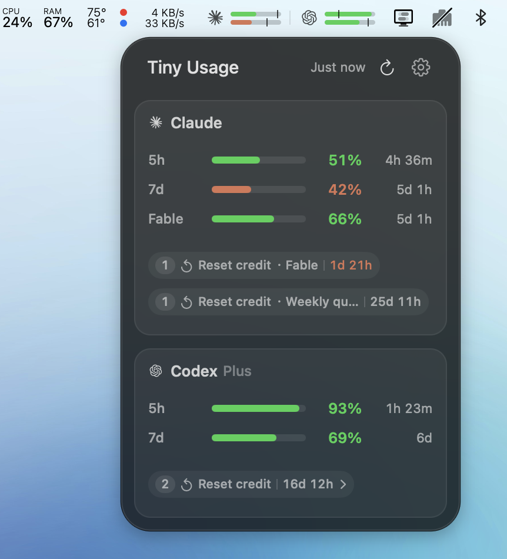

<h1 align="center">Tiny Usage</h1>

<p align="center">
  See how much Claude and Codex quota you have left and when it resets. Right from your Mac’s menu bar.
</p>

<p align="center">
  <strong><a href="https://github.com/AhaYue/tiny-usage/releases/latest/download/TinyUsage.dmg">Download for Mac</a></strong>
  · <a href="https://tiny-usage.ayue.dev/en">Website</a>
  · <a href="README.zh-CN.md">简体中文</a>
  <br>
  macOS 14+ · Apple Silicon · About 1 MB
</p>

<p align="center">
  
</p>

## See what’s left at a glance

- See **Claude and Codex** side by side.
- Check the **time marker** to see if your quota will last until reset.
- **Open the panel** to see your reset credits.

## Native and lightweight

Built with Swift, AppKit, and SwiftUI. No WebView, Electron, or Node.js. Closing the panel releases its view. The menu bar redraws once a minute and pauses during sleep.

| DMG download | Memory footprint¹ | Idle CPU¹ | Third-party dependencies |
| :---: | :---: | :---: | :---: |
| **About 1 MB** | **32.5 MiB** | **0.17%** | **1** (Sparkle) |

¹ Memory and CPU were sampled over 30 seconds with the panel closed on an Apple Silicon build predating Sparkle. CPU is measured as a percentage of one core. [Performance notes](docs/PERFORMANCE.md)

## Get started

With Homebrew:

```sh
brew install --cask ahayue/tap/tiny-usage
```

Or [download the DMG](https://github.com/AhaYue/tiny-usage/releases/latest/download/TinyUsage.dmg) and drag **Tiny Usage** to **Applications**.

<details>
<summary>Download the DMG with curl</summary>

```sh
curl -fL -o TinyUsage.dmg \
  https://github.com/AhaYue/tiny-usage/releases/latest/download/TinyUsage.dmg && open TinyUsage.dmg
```

</details>

If macOS blocks the first launch, go to **System Settings → Privacy & Security → Open Anyway**.

Use Claude Code as usual to populate the Claude card. For Codex, Tiny Usage can use your existing CLI login and local session history.

Tiny Usage checks for updates automatically. To check manually, open **Settings → Check for updates**.

## How Tiny Usage reads your quota

Tiny Usage uses your existing Claude and Codex setup. It has no Tiny Usage account, backend, or telemetry. Where available, it queries Anthropic or OpenAI directly from your Mac.

On first launch, Tiny Usage connects to the Claude Code status line. You can disconnect it in Settings.

<details>
<summary>Claude Code setup, optional authorization, and data sources</summary>

- **Claude Code.** Tiny Usage wraps `statusLine` in `~/.claude/settings.json` and keeps your existing status line running. It backs up the file as `settings.json.tiny-usage-backup` and saves only quota percentages and reset times from the status line. Use **Settings → About → Claude status line → Disconnect** to restore the original setup. Tiny Usage will only reconnect if you ask it to.
- **More Claude details.** To get model limits and reset credits from Anthropic, authorize access from the Claude card using your existing Claude Code or Claude Desktop login. macOS asks for Keychain access only after you confirm. Tiny Usage reads these credentials without refreshing or writing them back.
- **Codex.** Tiny Usage can use the CLI’s existing login to query OpenAI. Local session files can also supply quota data.

</details>

<details>
<summary>Build from source</summary>

With Xcode and Swift 6, run `bash scripts/build-app.sh release` from the repository root to create `dist/Tiny Usage.app`.

</details>

[MIT License](LICENSE) · Based on [Mimir](https://github.com/erayendes/mimir) · Updates by [Sparkle](https://github.com/sparkle-project/Sparkle) · Menu bar design inspired by [ai-usage](https://github.com/wawaka/ai-usage)
