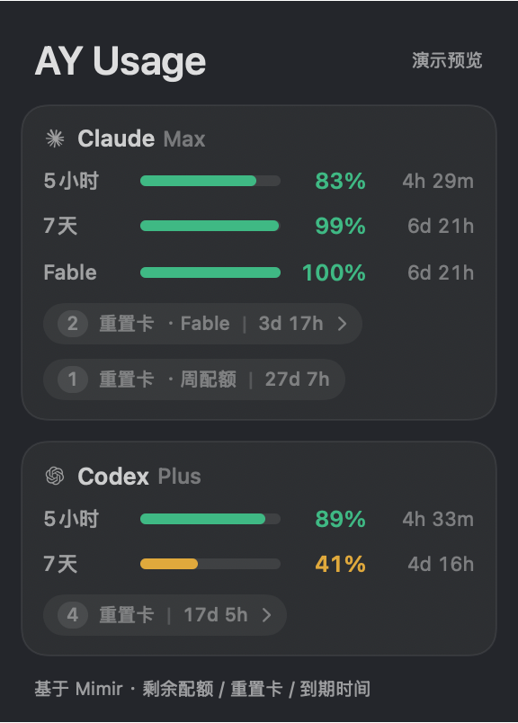

# Tiny Usage

基于 [Mimir](https://github.com/erayendes/mimir) 的原生 macOS 菜单栏配额 App，首版支持 **Claude + Codex**。保留 Mimir 的配额卡片、模型细分、重置卡与到期时间；菜单栏独立实现服务图标、上下双条、时间游标及百分比，颜色按剩余量变化（≥50% 绿、20–49% 橙、<20% 红）。

Swift / AppKit / SwiftUI，macOS 14+。当前构建为 Apple Silicon 版本，无 WebView、Electron、Node 运行时或第三方 Swift 包依赖。

## 打开

构建产物位于 `dist/Tiny Usage.app`，双击即可启动。也可以在本目录执行：

```sh
open "dist/Tiny Usage.app"
```

默认显示剩余量。点击菜单栏打开卡片，右键可快速切换显示模式、样式和退出。设置里的「显示数值」（剩余量 / 已用量）同时作用于菜单栏和面板，颜色始终按剩余量判断；「菜单栏样式」「刷新频率」为下拉选择。

- **Claude**：优先使用新鲜的本地 statusLine 数据；完整数据按调度补充。首次没有数据时，卡片直接提供「开启本地采集」和可选的「主动查询」。本地采集区分尚未开启、等待首次配额与记录过期；拒绝钥匙串权限也可继续使用本地采集。普通刷新和打开面板不会弹出钥匙串授权框，只有点击「主动查询」并确认后才可能请求系统授权。
- **Codex**：读取已有 CLI 登录，查询配额和重置卡；网络失败后尝试本地配额事件与上次快照。
- **Claude Desktop**：「主动查询」会启用此来源，并按需请求桌面会话权限，以补充重置卡；已有 Claude Code 授权不会跳过这一步。授权后可在后台静默更新，与本地采集开关独立。未确认属于同一组织时单独显示 Desktop 卡片。
- **重置卡**：显示数量、服务端提供的适用范围、到期倒计时。多张卡可展开查看；已到期的卡不继续列为可用。只展示数据，不自动消耗或兑换重置卡。
- **数据状态**：显示来源和采集时间。缺失配额保持未知；跨过重置时间的旧记录不会自动变成“满额”。从旧数据保留的附加项目会说明来源。
- **配额显示**：每个窗口和模型细分各占一行：名称、进度条、剩余百分比、行末重置倒计时（如 `6d 20h`、`2h 30m`，各卡片对齐成一列）；悬停显示具体重置时刻。颜色只看剩余量，与菜单栏一致。悬停服务名可看数据来源与采集时间，顶部显示最近更新时间。
- **时间游标**：菜单栏每根条上的细竖线，与条同向移动——显示剩余量时它是剩余时间（从右往左走），显示已用时是已过时间。填充越过游标表示配额比时间宽裕；游标不影响颜色。

私有用量接口、客户端字段与账号权益可能变化。没有返回的重置卡或适用范围不会凭空补造。

## 本地 statusLine 采集

只在引导卡片或设置里主动启用时安装，不在启动或后台刷新时修改 Claude Code 配置。启用后需等待 Claude Code 状态栏提供配额；仅登录或执行 `/status` 不保证立即生成数据。无需为采集额外发消息，额度耗尽仍可显示已有配额（剩余 0%）。若本地暂时没有配额，可选择主动查询。

- 自有文件：配置目录中的 `tiny-usage-statusline.sh`、`tiny-usage.json`、`tiny-usage-statusline-backup.json`。
- 配置备份：`settings.json.tiny-usage-backup`。
- 保存完整原 `statusLine` 对象，保持原命令 stdin、stdout 和附加字段；采集器只落盘配额字段，不保存完整状态栏输入。
- 使用独立的 Foundation 小程序处理输入，不启动整个 GUI App。
- 关闭时只恢复属于本 App 的 statusLine 字段，保留安装后的其他设置。检测到外部修改则保留现场并提示，不覆盖整个配置文件。
- 已有的 statusLine（包括 Mimir 的 hook）一律按普通命令包装并继续运行，不读取其他工具的数据文件。

应用状态存于 `~/Library/Application Support/Tiny Usage/`，凭证镜像使用独立的 `TinyUsage-claude-oauth` Keychain service。其他工具的 token 不刷新、不旋转、不写回；过期后由原客户端重新登录。

## 内存与后台工作

- 去掉上游的 Sentry、TelemetryDeck 依赖，以及 Widget（桌面小组件、App Group 共享快照）和 `mimir://` 深链路由。
- 不含 Antigravity：上游的 Antigravity 取数（本地 language server、Cockpit 凭据与缓存、`agy` CLI）、卡片分组及相关测试已全部移除，只保留 Claude 与 Codex。
- 面板关闭后释放 NSHostingView 和 TimelineView，并注销面板及事件监听。
- 一个 60 秒定时器负责重画菜单栏（倒计时、游标，只在内存中绘制），带 10 秒容差；睡眠时停止，唤醒后恢复。
- **刷新频率**可在设置中选择：自动（每分钟读本地，网络 2–30 分钟自适应，重置时刻补一次）、每 5 / 15 / 30 分钟（本地读取和网络请求都不快于该间隔，不在重置时刻额外请求）、仅手动（只在点「刷新用量」或卡片上的「授权」时读取）。
- 网络按账号自适应调度：数据变化时回到刷新频率的下限（自动为 120 秒），稳定时逐步退避，最长 1800 秒或所选间隔。补充接口也有独立的持久化冷却。
- HTTP 429 的 Retry-After 支持秒数和日期；手动刷新不会绕过冷却。
- Codex 历史目录索引缓存 5 分钟，只保留最近 8 个候选文件；每份文件最多读取末尾 1 MiB，不把整段会话存进 App 状态。
- 品牌图标在内存缓存；菜单栏直接绘制 NSImage，不反复生成临时图片。

实测条件、原始采样及限制见 [性能记录](docs/PERFORMANCE.md)。这些是短时测量，不代表长期稳定性保证。

## 构建和测试

需要 Xcode 工具链（本机验证 Swift 6.2.4）。在本目录执行：

```sh
bash scripts/test.sh
bash scripts/build-app.sh release
```

测试脚本设置独立的测试 HOME 和状态目录，不访问真实 Keychain 或 Desktop 登录。核心回归覆盖配额、真实窗口长度、重置卡、过期快照、请求冷却、状态栏恢复及有界日志读取。

应用代码位于 `TinyUsageCore` 模块，可执行目标为 `TinyUsage`，bundle 标识为 `dev.tinyusage.macos`。

本地包使用 ad-hoc 签名，也可通过 `SIGN_IDENTITY` 指定本机签名身份；当前没有商店发布、公证或自动更新流程。需要登录自启时，建议先将 App 放入 Applications，再从设置开启。

## 发布与自动更新

应用内更新使用 [Sparkle](https://github.com/sparkle-project/Sparkle)：每天后台检查一次，设置里也有「检查更新」。发布流程全部在 GitHub Actions（`.github/workflows/release.yml`）里完成：

1. 在 `CHANGELOG.md` 顶部加一节 `## [x.y.z]` 写更新内容，提交并推送到 `main`。
2. 推送标签：`git tag vx.y.z && git push origin vx.y.z`。
3. Actions 依次运行测试、构建、打包 `TinyUsage-x.y.z.zip`（应用内更新用）和 `.dmg`（首次安装用），用 Sparkle 私钥签名，创建 GitHub Release，最后把新条目写进 `main` 上的 `appcast.xml`。

- 版本号取自标签，`CFBundleVersion` 由 `scripts/build_number.sh` 换算，必须逐版递增。
- 更新签名私钥（EdDSA）保存在 GitHub Secret `SPARKLE_PRIVATE_KEY` 和本机登录钥匙串（服务 `https://sparkle-project.org`，账户 `tiny-usage`）。公钥写在 `scripts/build-app.sh`。私钥丢失后，已安装的旧版本将无法再收到更新。
- 应用用临时签名，未经 Apple 公证：首次从 DMG 安装需右键「打开」放行；之后的应用内更新不再提示。
- 更新源和下载地址都在 GitHub 上，仓库需公开才能让用户收到更新。

## 新用户复测

```sh
bash scripts/restart-as-new-user.sh
```

命令重新构建并退出所有 Tiny Usage 实例，用独立应用身份和空的应用缓存模拟首次安装。保留机器上已有的 Claude Code / Codex 登录、配置及本地记录，Codex 可直接发现已有 JSON / JSONL。只隔离 Tiny Usage 自己的偏好、快照、令牌镜像和授权状态；已有钥匙串授权不会被自动复用。本会话主动授权后才允许读取对应凭据。终端会打印本次会话目录，应用保持打开供手动操作。

## 预览和复测

```sh
"dist/Tiny Usage.app/Contents/MacOS/TinyUsage" --render-preview "$PWD/docs/preview.png"
"dist/Tiny Usage.app/Contents/MacOS/TinyUsage" --smoke-test "$PWD/docs/runtime"
```

以上两种模式只使用明确标注的合成数据，不安装 hook、不查询账号。smoke-test 会驱动 AppKit 菜单栏按钮、点击设置、切换显示、关闭和重新打开，保存真实窗口截图及结果。退出该演示进程后重新打开 App，回到正常模式。

正常模式下关闭面板后，可用 PID 进行只读性能采样：

```sh
python3 -I scripts/profile.py <PID> docs/runtime/performance-idle.json
vmmap -summary <PID>
```



## 授权来源

Tiny Usage 以 MIT 许可发布，见 [LICENSE](LICENSE)；其中保留了上游 [Mimir](https://github.com/erayendes/mimir)（MIT）的版权声明，详见 [THIRD_PARTY_NOTICES.md](THIRD_PARTY_NOTICES.md)。[ai-usage](https://github.com/wawaka/ai-usage) 未声明开源许可，仅作为显示交互参考，本项目未复制其绘图源码或素材。
