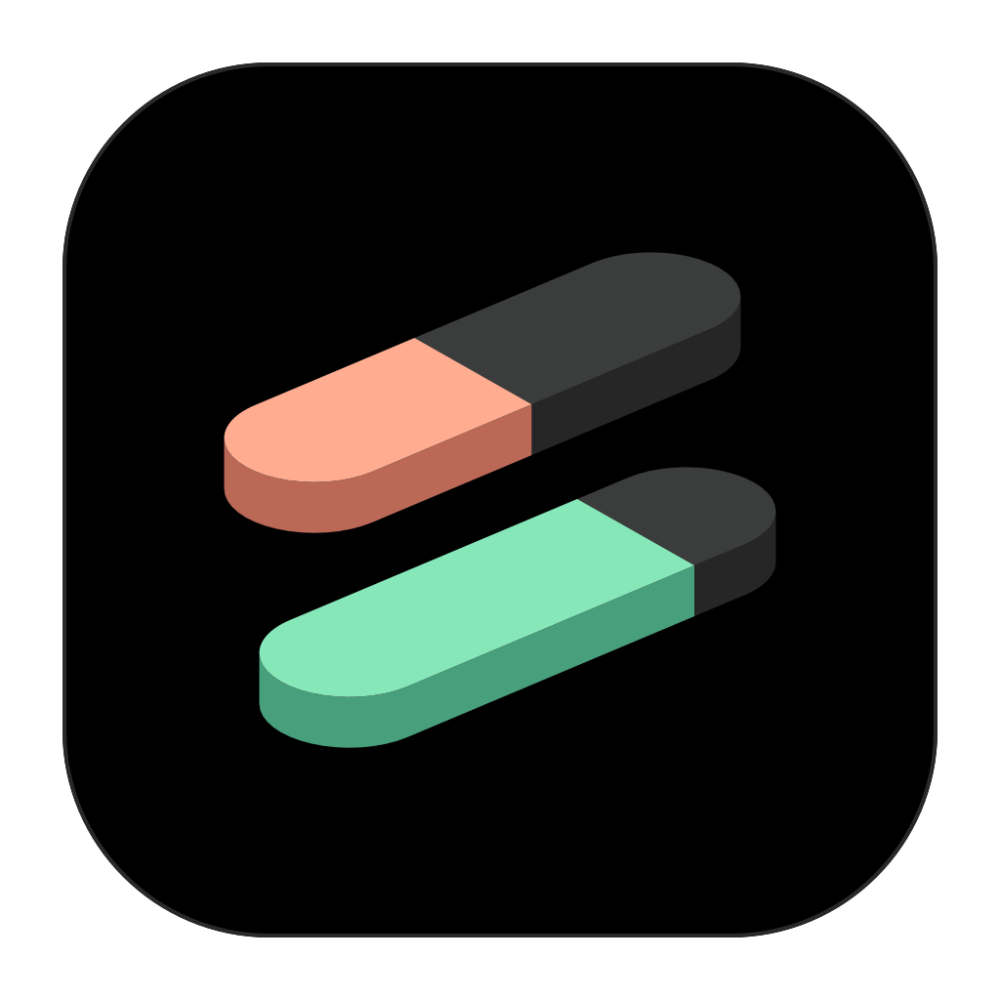

<p align="center">
  
</p>

<h1 align="center">Tiny Usage</h1>

<p align="center">
  在 Mac 菜单栏查看 Claude、Codex 和 OpenCode Go 的剩余额度和重置时间。
</p>

<p align="center">
  <a href="https://tiny-usage.ayue.dev">官网</a>
  · <strong><a href="#安装">安装</a></strong>
  · <a href="https://github.com/AhaYue/tiny-usage/issues">反馈</a>
  · <a href="README.en.md">English</a>
</p>

<p align="center">
  <a href="https://github.com/AhaYue/tiny-usage/releases/latest"></a>
  <a href="https://github.com/AhaYue/tiny-usage/actions/workflows/ci.yml?query=branch%3Amain+event%3Apush"></a>
  
  
  <a href="LICENSE"></a>
</p>

<p align="center">
  
</p>

<p align="center"><strong>不想动手，抬眼即知。</strong></p>

## 安装

需要搭载 Apple 芯片、运行 macOS 14 或更高版本的 Mac。

```sh
brew install --cask ahayue/tap/tiny-usage
```

也可以[下载 DMG](https://github.com/AhaYue/tiny-usage/releases/latest/download/TinyUsage.dmg)（约 1 MB），打开后将 **Tiny Usage** 拖入 **应用程序**。

### 首次启动

如果 macOS 拦截首次启动，前往 **系统设置 → 隐私与安全性 → 仍要打开**。

如果你已登录 Claude Code，Tiny Usage 首次打开就可以查询配额。它也可以读取 Codex 已有的 CLI 登录和本地会话记录。要添加 OpenCode Go，打开 **设置 → OpenCode Go**。

应用支持自动检查更新，也可以在 **设置 → 检查更新**中手动检查。

在 **设置 → 语言**中可选择「跟随系统」「English」或「简体中文」，切换即时生效。

## 功能

- 菜单栏的额度条用竖线标记当前周期离重置还有多久。点开面板可查看具体百分比、重置倒计时和可用的重置卡。
- 在 **设置 → 在菜单栏显示** 可分别勾选 Claude、Codex 和 OpenCode Go。不勾选任何服务时，菜单栏仍会保留 Tiny Usage 图标，点开即可查看所有服务。
- 在 **设置 → 菜单栏配色** 可以选择「默认色彩」「低调」或「自定义颜色」。低调模式下，剩余配额达到 50% 的额度条和数字跟随菜单栏图标的颜色。自定义模式可以点击任一档的色块，用十六进制色值或 RGB 滑块调整颜色。

## 用量从哪里来

Tiny Usage 使用你已有的 Claude 和 Codex 环境，也可选接入 OpenCode Go。无需注册，无自建服务器，也不收集遥测数据。配额查询由你的 Mac 直接连接服务商。

首次启动会自动接入 Claude Code 的状态栏，可在设置里移除。

<details>
<summary>服务接入、可选授权与数据来源</summary>

- **Claude Code。** Tiny Usage 会接入 `~/.claude/settings.json` 里的 `statusLine`，让原有状态栏照常运行，并备份配置文件为 `settings.json.tiny-usage-backup`。状态栏采集只保存配额百分比和重置时间。缺少新数据时，Tiny Usage 可让已登录的 Claude Code 执行内置 `/usage`，查询 5 小时和每周配额。在 **设置 → 关于 → Claude 状态栏 → 移除接入**可以恢复原有状态栏，之后由你决定是否重新接入。
- **更多 Claude 明细。** 要从 Anthropic 获取模型配额和重置卡，可以在 Claude 卡片上授权使用已有的 Claude Code 或 Claude 桌面应用登录。你确认后，macOS 才会请求钥匙串权限。Tiny Usage 只读取凭据，不刷新或写回。
- **Codex。** Tiny Usage 可以使用已有的 CLI 登录向 OpenAI 查询配额。本地会话文件和登录来自同一个 Codex 目录，自定义 `CODEX_HOME` 时也一样。
- **OpenCode Go。** 在 **设置 → OpenCode Go** 复用 `opencode-go` 已连接的 API key，或填写套餐所在工作区的个人 key。手动填写的 key 存在 macOS 钥匙串，用来查询 5 小时、每周和月度额度。点 **打开账单** 可前往 OpenCode Console 查看工作区充值余额。

</details>

<details>
<summary>性能</summary>

应用使用 Swift、AppKit 和 SwiftUI 开发，通过 Sparkle 更新。关闭面板后会释放视图。菜单栏每分钟重绘一次，Mac 睡眠时暂停。

在关闭面板的情况下，集成 Sparkle 前的 Apple 芯片版本占用 32.5 MiB 物理内存，30 秒内平均占用单核 CPU 的 0.17%。见[性能实测](docs/PERFORMANCE.md)。

</details>

<details>
<summary>从源码构建</summary>

使用带 Swift 6 的 Xcode 工具链，在仓库根目录运行 `bash scripts/build-app.sh release`，生成 `dist/Tiny Usage.app`。

</details>

[MIT 许可](LICENSE) · 源自 [Mimir](https://github.com/erayendes/mimir) · [Sparkle](https://github.com/sparkle-project/Sparkle) 提供应用内更新 · 菜单栏设计参考 [ai-usage](https://github.com/wawaka/ai-usage)
