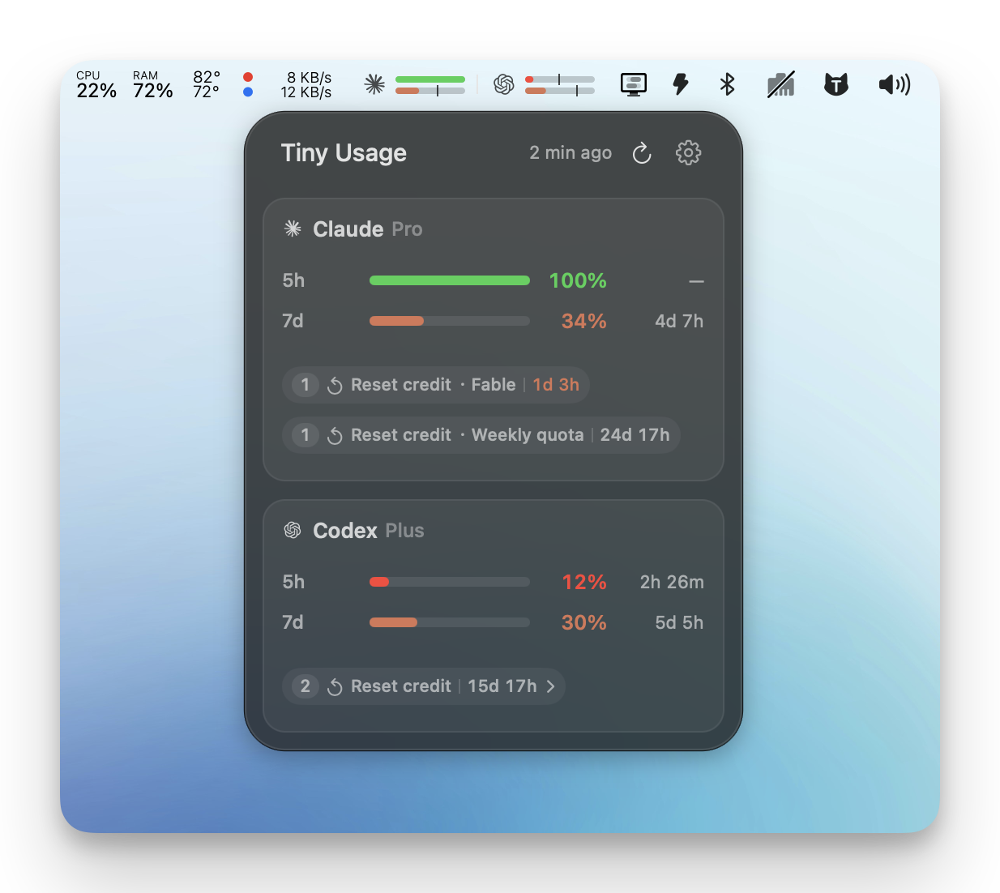

<p align="center">
  
</p>

<h1 align="center">Tiny Usage</h1>

<p align="center">
  在 Mac 菜单栏查看 Claude、Codex 和 OpenCode Go 的剩余额度和重置时间。
</p>

<p align="center">
  <a href="https://tiny-usage.ayue.dev">官网</a>
  · <strong><a href="#安装">安装</a></strong>
  · <a href="https://github.com/AhaYue/tiny-usage/issues">反馈</a>
  · <a href="README.en.md">English</a>
</p>

<p align="center">
  <a href="https://github.com/AhaYue/tiny-usage/releases/latest"></a>
  <a href="https://github.com/AhaYue/tiny-usage/actions/workflows/ci.yml?query=branch%3Amain+event%3Apush"></a>
  
  
  <a href="LICENSE"></a>
</p>

<p align="center">
  <em>有些数字，挂在菜单栏才安心。</em><br>
  CPU 40%、RAM 76%、温度 56 °C。<br>
  嗯…… and ...
</p>

<p align="center">
  
</p>

<p align="center"><strong>不想动手，抬眼即知。</strong></p>

## 安装

需要搭载 Apple 芯片、运行 macOS 14 或更高版本的 Mac。

```sh
brew install --cask ahayue/tap/tiny-usage
```

也可以[下载 DMG](https://github.com/AhaYue/tiny-usage/releases/latest/download/TinyUsage.dmg)（约 1 MB），打开后将 **Tiny Usage** 拖入 **应用程序**。

### 首次启动

如果 macOS 拦截首次启动，前往 **系统设置 → 隐私与安全性 → 仍要打开**。

已登录的 Claude Code 和 Codex 可以直接使用。OpenCode Go 在 **设置 → OpenCode Go** 接入。


## 功能

- **菜单栏**：额度条显示剩余额度，竖线标记重置进度。
- **详情面板**：点开查看剩余百分比、重置倒计时和可用的重置卡。
- **服务显示**：选择哪些服务出现在菜单栏。
- **配色**：支持默认、低调或自定义配色。
- **语言**：支持简体中文、English，也可跟随系统。
- **更新**：自动检查，也可在设置中手动检查。


## 后续维护

我做 Tiny Usage，是因为想抬眼就知道还剩多少额度、什么时候重置，省去打开网页或输入命令的步骤。这个小工具把这件事做好就够了。

为了让 App 保持轻量，后续只维护 Claude、Codex 和 OpenCode Go 的额度显示，不接入其他服务或第三方 API 路由，也不提供 API 账户余额查询。


## 用量从哪里来

无需注册。配额由你的 Mac 直接向服务商查询，Tiny Usage 没有自建服务器，也不收集遥测数据。

<details>
<summary>服务接入与授权</summary>

- **Claude Code**：首次启动会自动接入并保留原有的 `statusLine`，备份配置，只采集额度百分比和重置时间。缺少新数据时，会尝试用已登录的 CLI 执行 `/usage`。在 **设置 → 关于 → Claude 状态栏 → 移除接入**可恢复原状，之后不会自动重新接入。
- **Claude 明细（可选）**：在 Claude 卡片授权使用 Claude Code 或 Claude 桌面应用的登录，可获取模型配额和重置卡。确认后才请求钥匙串权限，凭据只读。
- **Codex**：使用已有的 CLI 登录查询配额，并读取同一 Codex 目录的本地会话记录，支持自定义 `CODEX_HOME`。
- **OpenCode Go**：复用 `opencode-go` 的 API key，或填写套餐所在工作区的个人 key。手动填写的 key 存在钥匙串。支持 5 小时、每周和月度额度；点 **打开账单** 可查看工作区充值余额。

</details>

<details>
<summary>性能</summary>

关闭面板后释放视图，菜单栏每分钟重绘，睡眠时暂停。集成 Sparkle 前的 Apple 芯片版本在面板关闭时占用 32.5 MiB 物理内存，30 秒内平均占用单核 CPU 的 0.17%。见[性能实测](docs/PERFORMANCE.md)。

</details>

<details>
<summary>从源码构建</summary>

使用带 Swift 6 的 Xcode 工具链，在仓库根目录运行 `bash scripts/build-app.sh release`，生成 `dist/Tiny Usage.app`。

</details>

[MIT 许可](LICENSE) · 源自 [Mimir](https://github.com/erayendes/mimir) · [Sparkle](https://github.com/sparkle-project/Sparkle) 提供应用内更新 · 菜单栏设计参考 [ai-usage](https://github.com/wawaka/ai-usage)
