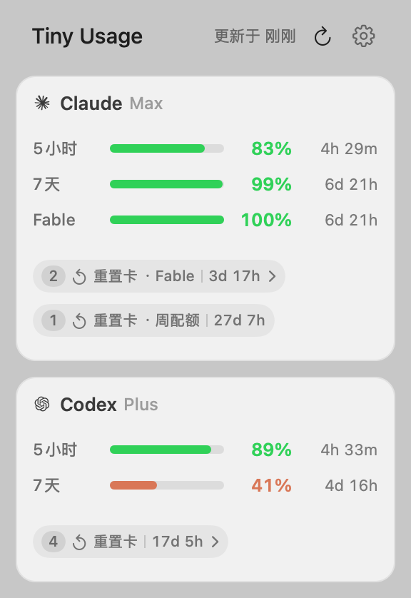

<h1 align="center">Tiny Usage</h1>

<p align="center">
  额度抬眼即知
</p>

<p align="center">
  <strong><a href="https://github.com/AhaYue/tiny-usage/releases/latest/download/TinyUsage.dmg">下载 Mac 版</a></strong>
  · <a href="https://tiny-usage.ayue.dev">官网</a>
  · <a href="README.md">English</a>
  <br>
  macOS 14+ · Apple Silicon · 下载约 1 MB
</p>

<p align="center">
  <picture>
    <source media="(prefers-color-scheme: dark)" srcset="docs/panel-zh-dark.png">
    
  </picture>
</p>

## 一眼看清

- **Claude 和 Codex** 并排看。
- **看竖线**，了解重置剩余时间。
- **点开面板**，查看重置卡。

## 原生，够轻

用 Swift、AppKit 和 SwiftUI 写的原生 Mac 应用，无 WebView、Electron 或 Node.js。关掉面板就释放视图，菜单栏每分钟重绘一次，Mac 睡眠时暂停。

| DMG 下载 | 物理内存¹ | 空闲 CPU¹ | 第三方依赖 |
| :---: | :---: | :---: | :---: |
| **约 1 MB** | **32.5 MiB** | **0.17%** | **1 个**（Sparkle） |

¹ 内存和 CPU 来自集成 Sparkle 前的 Apple Silicon 构建，面板关闭后空闲采样 30 秒。CPU 按单核计算。[性能实测](docs/PERFORMANCE.md)

## 下载和安装

通过 Homebrew 安装。

```sh
brew install --cask ahayue/tap/tiny-usage
```

也可以[下载 DMG](https://github.com/AhaYue/tiny-usage/releases/latest/download/TinyUsage.dmg)，把 **Tiny Usage** 拖进 **应用程序**。

<details>
<summary>用 curl 下载 DMG</summary>

```sh
curl -fL -o TinyUsage.dmg \
  https://github.com/AhaYue/tiny-usage/releases/latest/download/TinyUsage.dmg && open TinyUsage.dmg
```

</details>

如果 macOS 拦截首次启动，前往 **系统设置 → 隐私与安全性 → 仍要打开**。

照常使用 Claude Code，Claude 卡片就会显示用量。Tiny Usage 可以读取 Codex 已有的 CLI 登录和本地会话记录。

应用支持自动检查更新，也可以在 **设置 → 检查更新**中手动检查。

## 用量从哪里来

Tiny Usage 使用你已有的 Claude 和 Codex 环境，无需注册，无自建服务器，也不收集遥测数据。需要查询配额接口时，由你的 Mac 直接连接 Anthropic 或 OpenAI。

首次启动会自动接入 Claude Code 的状态栏，可在设置里移除。

<details>
<summary>Claude Code 接入、可选授权与数据来源</summary>

- **Claude Code。** Tiny Usage 会接入 `~/.claude/settings.json` 里的 `statusLine`，让原有状态栏照常运行，并备份配置文件为 `settings.json.tiny-usage-backup`。采集只保存配额百分比和重置时间。在 **设置 → 关于 → Claude 状态栏 → 移除接入**可以恢复原有配置，之后由你决定是否重新接入。
- **更多 Claude 明细。** 要从 Anthropic 获取模型配额和重置卡，可以在 Claude 卡片上授权使用已有的 Claude Code 或 Claude 桌面应用登录。你确认后，macOS 才会请求钥匙串权限。Tiny Usage 只读取凭据，不刷新或写回。
- **Codex。** Tiny Usage 可以使用已有的 CLI 登录向 OpenAI 查询配额，也可以从本地会话文件读取用量。

</details>

<details>
<summary>从源码构建</summary>

使用带 Swift 6 的 Xcode 工具链，在仓库根目录运行 `bash scripts/build-app.sh release`，生成 `dist/Tiny Usage.app`。

</details>

[MIT 许可](LICENSE) · 源自 [Mimir](https://github.com/erayendes/mimir) · [Sparkle](https://github.com/sparkle-project/Sparkle) 提供应用内更新 · 菜单栏设计参考 [ai-usage](https://github.com/wawaka/ai-usage)
